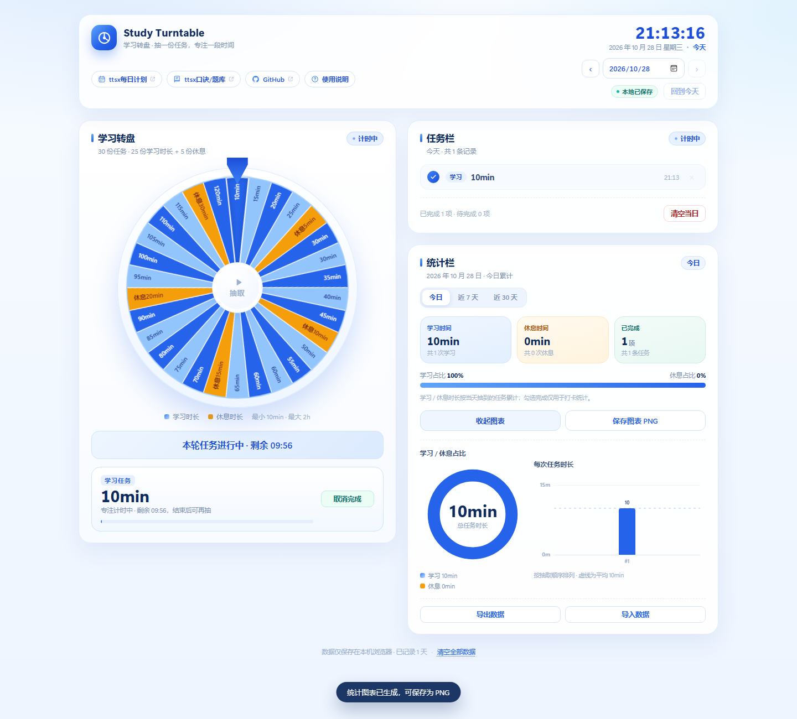

# Study Turntable · 学习转盘

一个纯前端、离线可用的学习任务转盘：转动转盘抽取一份「学习 / 休息」时长任务，抽到学习必须等计时结束才能再抽，抽到休息则可以跳过、直接抽下一轮；记录保存在任务栏里，统计栏支持今日 / 近 7 天 / 近 30 天的累计数据与简约图表，可保存图表 PNG、查看往日数据。



## 快速开始

无需安装依赖、无需联网、无需构建：

1. 双击打开 `index.html`（推荐 Edge / Chrome / Firefox 等现代浏览器）；
2. 或在本目录启动一个本地静态服务器（可选）：

   ```powershell
   python -m http.server 8000
   # 浏览器打开 http://localhost:8000
   ```
3. 本仓库已部署，可用浏览器直接访问：<https://lulu3103.github.io/Study-Turntable/>

所有数据保存在浏览器的 `localStorage` 中（键名 `study-turntable:v1`），刷新或重开页面都不会丢失。

## 功能说明

### 顶栏快捷入口

顶栏提供四个快捷按钮，前三个在新标签页打开：

- **ttsx每日计划**
- **ttsx口诀/题库**
- **GitHub**：直达本项目仓库
- **使用说明**：点击弹出简洁使用说明（支持关闭按钮、点击遮罩、按 Esc 关闭）

### 学习转盘（30 份内容）

- **25 份学习时长**：10min、15min … 120min（2h），步长 5min（30min 与 60min 各出现两次，凑满 25 份）；
- **5 份休息时长**：5 / 10 / 15 / 20 / 30min；
- 点击转盘下方「抽取学习任务」或转盘中心的「抽取」按钮开始旋转，缓动结束后指针指向的扇区即为抽到的任务；
- 抽中结果自动写入当天任务栏，并在结果卡片中显示；结果卡片提供「标记完成 / 再抽一次」，抽到休息时按钮变为「跳过休息」。

> 视觉上，25 个学习扇区以深浅蓝交替，5 个休息扇区用暖橙色点缀，30 个扇区均可清晰读数。

### 任务计时（学习必须等，休息可跳过）

- **抽到学习任务**：立即开始倒计时，**时长结束前不能再次抽取**，也没有「放弃本轮」之类的跳过入口；计时期间该条记录的删除按钮也会禁用，结束后恢复；
- **抽到休息任务**：显示休息倒计时，但**不会锁定抽签**，可以点「跳过休息」立即抽下一轮，休息记录仍会保留在任务栏；
- 学习等待期间抽取按钮显示剩余时间，结果卡片显示进度条，转盘 / 任务栏状态显示「计时中」；休息期间状态显示「休息中」；
- 倒计时按记录时间计算，刷新页面、关闭再打开、跨过零点都会继续有效。

### 任务栏

- 顶栏包含实时时钟（时:分:秒）、日期选择器、前一天 / 后一天、回到今天；
- 选择任意历史日期即可查看当天保存的任务记录与统计（历史日期为只读，不能抽签）；
- 每条任务可勾选完成、删除（本轮学习计时中的那条在结束前不可删除）；可一键清空当天记录；
- 数据保存在本地，切换到往日日期即可查看过往数据。

### 统计栏

- 时间范围切换：**今日 / 近 7 天 / 近 30 天**（以当前查看的日期为最后一天向前倒推）；
- 统计所选范围内的**学习总时长、休息总时长、已完成任务数**，以及学习 / 休息占比条；
- 时间范围说明：近 7 天 / 近 30 天会显示日期区间、有记录天数与日均学习时长；
- 点击「生成统计图表」绘制环形图 + 柱状图（今日为每次任务时长，多日为每日学习 / 休息堆叠时长，均含平均值虚线）；
- 再点一次「收起图表」即可折叠图表区域，页面更简洁；
- 「保存图表 PNG」导出带日期 / 区间与汇总信息的统计图（1100×660 @2x，多日图表文件名带 `-7d` / `-30d` 后缀）；
- 「导出数据 / 导入数据」用于 JSON 备份与恢复；页脚可清空全部数据。

> 统计口径：学习 / 休息时长按**抽到的任务**累计；勾选完成仅用于打卡计数，不影响时长汇总。近 7 / 30 天的日均学习时长按「有记录的天数」计算。

## 数据存储与备份

- 存储位置：浏览器 `localStorage`，按浏览器与打开方式（文件路径 / 域名）隔离；
- 备份：统计栏「导出数据」生成 `study-turntable-data-YYYYMMDD.json`；
- 恢复：统计栏「导入数据」选择备份文件，同日期数据会被覆盖；
- 清空：任务栏「清空当日」或页脚「清空全部数据」（均有二次确认）；
- 若浏览器禁用了本地存储，页面会提示，数据仅在当前页面内有效。

## 项目结构

```text
study-turntable/
├─ index.html          页面结构（三部分：学习转盘 / 任务栏 / 统计栏）
├─ css/
│  └─ styles.css       蓝色简约风格、响应式布局、动画
├─ js/
│  ├─ core.js          转盘配置、角度计算、学习 / 休息计时、日期与范围统计等纯函数
│  ├─ wheel.js         Canvas 绘制 30 扇区 + requestAnimationFrame 旋转动画
│  ├─ charts.js        简约环形图 / 柱状图绘制与 PNG 导出
│  └─ app.js           本地数据、抽签与计时、任务栏、统计栏、使用说明、导入导出
└─ tests/
   ├─ run-tests.js     核心逻辑单元测试（Node）
   ├─ screenshot.js    无头 Edge 端到端验收 + 截图
   └─ shots/           验收截图与导出样例
```

## 自测

```powershell
# 核心逻辑单元测试（无需浏览器）
node tests/run-tests.js

# 浏览器端验收（需要本机安装 Edge；会生成 tests/shots 截图与导出样例）
node tests/screenshot.js
```

验收覆盖：页面加载、顶栏四个入口与使用说明弹窗、转盘 30 份内容、抽签与学习计时倒计时、学习计时期间禁止重复抽取 / 禁止删除记录、休息任务跳过计时、打卡、图表生成与收起、今日 / 近 7 天 / 近 30 天统计、保存 PNG、导出 JSON、历史日期只读、学习计时到期恢复、刷新后数据恢复、移动端无横向溢出、控制台无报错。

## 自定义

- **调整转盘内容**：编辑 `js/core.js` 中的 `STUDY_MINUTES`（25 个）与 `REST_POSITIONS`（5 个），保持总数 30 即可，角度与落点计算会自动适配；
- **调整主题色**：编辑 `css/styles.css` 顶部的 `:root` 变量（`--blue-*`、`--ink` 等）；
- **调整计时规则**：`js/core.js` 中 `findCooldown` 控制「学习任务时长结束前不能再次抽取」，`findRestTimer` 控制休息倒计时（可跳过）；两者都用记录里的 `createdAt` 推算，刷新后依然有效；
- **调整统计口径**：如需仅统计「已完成」任务的时长，可在 `js/core.js` 的 `summarize` 中把累加逻辑限定为 `record.done`。

## 兼容性

- 需要支持 Canvas、CSS Grid、`ResizeObserver` 与 `localStorage` 的现代浏览器（Chrome / Edge 88+、Firefox 90+、Safari 15+）；
- 已适配 `prefers-reduced-motion`（减少动画）；
- 页面无任何第三方依赖或网络请求，完全离线运行。
